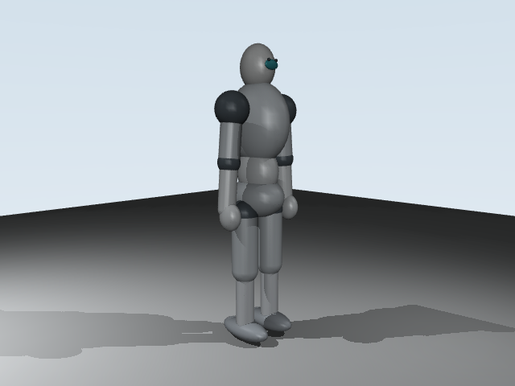

# Robot voltereta

Proyecto de simulación y aprendizaje por refuerzo para un humanoide que intenta dar una voltereta frontal y aterrizar de pie. MuJoCo calcula la física; el entorno de control está en C++; PPO y la política usan Python y PyTorch.

## Cómo se conectan las partes

1. `assets/humanoid.xml` define la geometría, masas, juntas, actuadores y suelo.
2. `cpp/robot_env.cpp` carga ese XML con la API C de MuJoCo. Su ABI C expone reset, paso, dimensiones, tiempo de simulación y errores.
3. `scripts/env.py` valida entradas/salidas y usa `ctypes` para comunicar NumPy con la biblioteca `build/librobot_env.so`.
4. `scripts/train.py` obtiene observaciones, produce torques y actualiza una red Actor-Critic mediante PPO; el checkpoint se escribe de forma atómica. Con `--render`, `scripts/visualizer.py` dibuja el entrenamiento sincronizando cada acción con una segunda simulación MuJoCo.
5. `scripts/play.py` carga el checkpoint y reutiliza el mismo visor sincronizado para reproducirlo.

Cada módulo tiene comentarios y docstrings que describen sus responsabilidades y contratos. La guía detalla aquí la secuencia completa de datos.

## Requisitos

- Linux x86_64, CMake, compilador C++17 y Python 3.11 o 3.12.
- MuJoCo instalado en el entorno Python (`mujoco`) y PyTorch (`torch`).
- GLFW/OpenGL disponibles para abrir la ventana de reproducción.

Python 3.14 está instalado en la máquina de desarrollo, pero PyTorch/MuJoCo no están presentes allí. Cree un entorno con Python 3.12 usando `uv` o `python3.12`.

## Preparación

```bash
cd ~/Desktop/robot-voltereta
uv venv --python 3.12 .venv
source .venv/bin/activate
python -m pip install --upgrade pip
python -m pip install -r requirements.txt
cmake -S . -B build -DCMAKE_BUILD_TYPE=Release -DPython3_EXECUTABLE="$VIRTUAL_ENV/bin/python"
cmake --build build -j
```

Si MuJoCo no encuentra GLFW en Linux, instale los paquetes de desarrollo de GLFW y OpenGL de su distribución. El entrenamiento sigue siendo headless por defecto; `--render` y la demo requieren una sesión gráfica.

## Uso

Entrenamiento corto para verificar el flujo:

```bash
python scripts/train.py --steps 20000
```

Entrenamiento más largo:

```bash
python scripts/train.py --steps 2000000
```

Entrenar viendo el movimiento en tiempo real:

```bash
python scripts/train.py --steps 2000000 --render --realtime
```

Para reducir el costo de dibujo, actualiza la ventana cada cinco acciones, manteniendo todos los pasos físicos:

```bash
python scripts/train.py --steps 2000000 --render --render-every 5
```

Cerrar la ventana gráfica desactiva el render y deja que PPO continúe en modo headless. `Ctrl+C` detiene el entrenamiento.

Reproducir la política guardada:

```bash
python scripts/play.py
```

El nuevo modelo tiene 27 motores y produce observaciones de 67 valores. El checkpoint previo de 8 motores (`checkpoints/robot.pt`) no es compatible. La política nueva se guarda por defecto en `checkpoints/robot-humanoid-v2.pt`; entrena de nuevo antes de reproducirla. Cada checkpoint contiene pesos, dimensiones, semilla, pasos, retornos por episodio y límite de torque. Las observaciones no se normalizan. Una voltereta estable no está garantizada por una ejecución corta.

## Diseño

- `assets/humanoid.xml`: pelvis, cintura y torso articulados, cabeza, brazos con hombros/codos/muñecas, piernas con caderas/rodillas/tobillos, pies elipsoidales y 27 motores.
- `cpp/robot_env.cpp`: simulación MuJoCo y ABI C pequeña consumida por `ctypes`.
- `scripts/env.py`: adaptador Python/ctypes con validación de forma, valores finitos, orden de reset y ciclo de vida.
- `scripts/train.py`: PPO continuo implementado con PyTorch; guarda checkpoint y estadísticas.
- `scripts/visualizer.py`: copia visual sincronizada usada por PPO y por la reproducción.
- `scripts/play.py`: carga un checkpoint y muestra la simulación en una ventana MuJoCo.

El controlador observa `qpos + qvel` (67 valores, incluida la pose libre del torso) y aplica torques acotados a 27 motores. El MJCF utiliza 19,65 kg de masa total distribuida entre pelvis, torso, cabeza y extremidades, con inercia explícita por segmento. Cápsulas, elipsoides y esferas redondean el contorno; los pies elipsoidales llegan al plano del suelo en la pose inicial. Los contactos estructurales entre pelvis, cintura, pecho y hombros se excluyen para evitar penetraciones internas. La recompensa favorece rotación frontal, mantener altura y terminar cerca de una rotación completa con el torso erguido. Una caída por altura fuera del intervalo permitido, un estado numérico no finito, un aterrizaje reconocido o alcanzar cinco segundos terminan el episodio. El código verifica formas y valores finitos antes y después de cruzar la interfaz C++/Python.

Vista renderizada desde el MJCF inicial:


